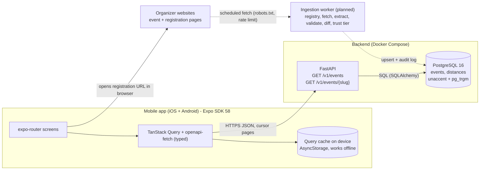
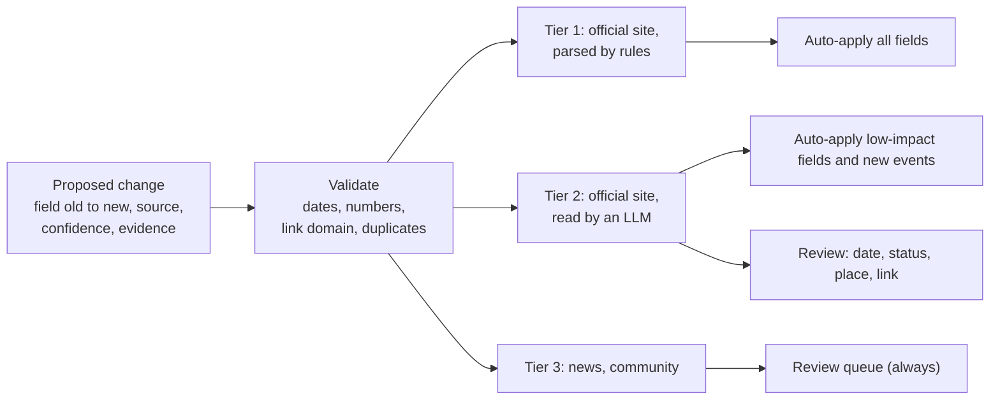

# Architecture and tech stack

Interactive diagrams (system, data-freshness pipeline, tech stack, decisions): https://claude.ai/artifact/SSqc3zJ4u7GyRyVsGm2YMU (private; open it from the owner's account or ask for access). The same content is summarised below so it can be read without that link.

State: 2026-11-06. Solid = built, dashed = planned.

## System

## Ingestion with tiered trust (planned, ADR 0003)

The AI only extracts and quotes evidence; deterministic checks decide validity; people review risky changes; every applied change is audit-logged.

## Tech stack

| Layer | Choice | State |
|---|---|---|
| Mobile app | Expo SDK 58, React Native 0.88, React 19, TypeScript strict, Expo Router | in progress |
| Data in the app | TanStack Query with persisted AsyncStorage cache, NetInfo, openapi-fetch + openapi-typescript | in progress |
| API | Python 3.12, FastAPI, Pydantic v2, SQLAlchemy 2, Alembic; versioned REST, keyset pagination, committed OpenAPI contract | built |
| Database | PostgreSQL 16, `unaccent`, `pg_trgm`, generated `search_text` column | built |
| Local and CI | Docker Compose, GitHub Actions (backend with Postgres service, mobile typecheck, gitleaks), Dependabot | built |
| Quality | pytest, ruff, Jest (jest-expo), tsc | in progress |
| Ingestion | Scheduled worker, LLM behind an adapter with replay mode | planned |
| Design | Figma file (colour variables, event card component), tokens mirrored in `src/theme` | built |

Decisions: see `docs/adr/` (0001-0007) and `docs/DESIGN-DECISIONS.md`.
